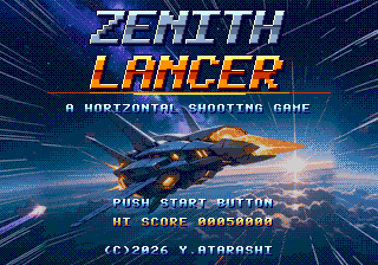
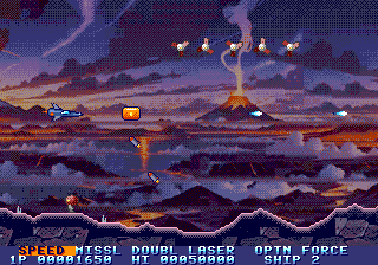
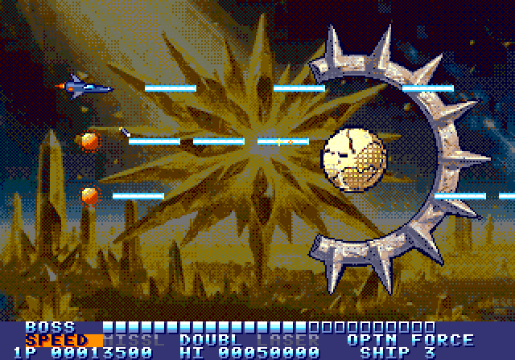

# ZENITH LANCER

English: [README.md](README.md)

ブラウザで遊べる横スクロールシューティングです。全6ステージ、6体の
ボス、カプセル式のパワーアップゲージ、自機を追いかけるオプション、
自動で飛ぶ AUTO PLAY、デモ、2周目があります。

**▶ [今すぐプレイ](https://yoshitakaatarashi.github.io/zenith_lancer/)**

---

## 操作

| 入力 | 動作 |
|---|---|
| ←↑↓→ / WASD | 移動 |
| Z / C / Space（押しっぱなし） | ショット |
| X | 光っているパワーアップを取る |
| Enter | 開始 / ポーズ（タイトルではメニュー） |
| C（ポーズ中） | タイトルに戻る |
| M / F | 音のオン・オフ / 全画面 |

ゲームパッド（標準配置）とタッチ操作にも対応しています。最初に一度
クリックかキーを押すと音が出ます。ハイスコアとオプションはブラウザに
保存されます。

## パワーアップ

赤く点滅する敵を倒すか、編隊を全滅させると赤いカプセルが出ます。
取るたびにゲージの光る位置が進み、X でそのパワーアップを取れます。

| ゲージ | |
|---|---|
| SPEED | 自機が速くなる（5段階） |
| MISSL | 地面を這うミサイル |
| DOUBL | 上方向の追加ショット |
| LASER | 貫通するビーム |
| OPTN | 自機を追いかけ、同じ攻撃をする補助機（最大4つ） |
| FORCE | 自機の前のバリア |

9個目ごとのカプセルは青で、画面の敵をすべて破壊します。やられると
パワーアップはなくなりますが、次の自機に向かって赤いカプセルが2つ
流れてきます。

## ステージ

| # | ステージ | ボス |
|---|---|---|
| 1 | Basalt Reach | Basalt Warden |
| 2 | Glacier Veil | Cryo Sentinel |
| 3 | Hive Nebula | Mother Cell |
| 4 | Sunken Archive | Abyssal Leviathan |
| 5 | Iron Citadel | Bastion Core |
| 6 | Zenith Gate | The Zenith |

最後のボスを倒すと、難しくなった2周目が始まります。

## メニューとオプション

タイトルのメニューには GAME START、AUTO PLAY（自機が自動で飛ぶ）、
OPTIONS、MUSIC MODE（全12曲）があります。タイトルを放っておくと
デモが始まります。

| オプション | |
|---|---|
| CONTINUE: OFF / INFINITE | やられた場所から3機で再開 |
| INVINCIBLE: OFF / ON | 自機が何にもやられない（ハイスコアは記録しない） |
| START STAGE: 1-6 | 新しいゲームを始めるステージ |

## 手元で遊ぶ

`index.html` をブラウザで開くだけです。インストールもビルドも不要で、
サーバーもいりません（`file://` のままで動きます）。

## コード

ライブラリを使わない素の JavaScript です。`js/display.js` がタイルの
画面とスプライトを canvas に描き、`js/system.js` がエンジンの機能
（転送、スクロール、パレットとフェード、入力、保存、フレームの時計）を
受け持ち、ゲーム本体は `js/` のほかのファイルです。曲は `music/`
（Opus。使えないブラウザでは MP3）、絵とステージのデータは
`data/assets.js` にあります。

(C) 2026 Y.ATARASHI
