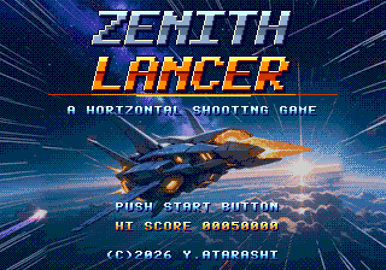
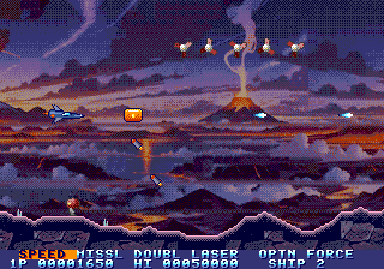
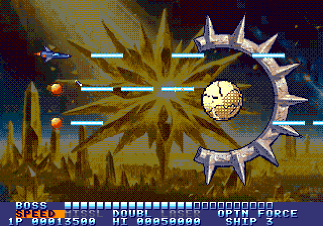

# ZENITH LANCER

日本語: [README.ja.md](README.ja.md)

A horizontal shooting game for the browser: six stages, six bosses, a
capsule power-up gauge, options that follow the ship, an AUTO PLAY pilot,
an attract demo and a second loop.

**▶ [Play now](https://yoshitakaatarashi.github.io/zenith_lancer/)**

---

## Controls

| Input | Action |
|---|---|
| Arrows / WASD | Move |
| Z / C / Space (hold) | Shoot |
| X | Take the lit power-up |
| Enter | Start / pause (on the title: the menu) |
| C (while paused) | Back to the title |
| M / F | Sound on/off / fullscreen |

Gamepads (standard layout) and touch screens work too. Click or press a key
once to start the sound. The high score and the options are kept in the
browser.

## Power-ups

Red capsules come from flashing carriers and from wiping out a whole
formation. Each one moves the lit slot of the gauge along, and X takes it:

| Slot | |
|---|---|
| SPEED | Faster ship (5 steps) |
| MISSL | Missiles that crawl along the ground |
| DOUBL | An extra shot upward |
| LASER | A beam that pierces |
| OPTN | A helper that follows you and copies your shots (up to 4) |
| FORCE | A barrier in front of the ship |

Every ninth capsule is blue and destroys everything on screen. A lost ship
loses its power-ups, but two red capsules drift in to help the next one.

## Stages

| # | Stage | Set piece | Boss |
|---|---|---|---|
| 1 | Basalt Reach | Erupting volcanoes, a dive through the cavern | Basalt Warden |
| 2 | Glacier Veil | An ice storm that piles up on the frozen lake | Cryo Sentinel |
| 3 | Hive Nebula | Walls that writhe and swing across the screen | Mother Cell |
| 4 | Sunken Archive | Giant clams blowing geysers | Abyssal Leviathan |
| 5 | Iron Citadel | A lift shaft, laser gates and rail laser cannons | Bastion Core |
| 6 | Zenith Gate | Captive stars: loops of flame and lasers | The Zenith |

After the last boss the game goes round again, harder.

## Menu and options

The title menu has GAME START, AUTO PLAY (the ship flies itself),
OPTIONS and MUSIC MODE (all 12 songs). Left alone, the title plays a demo.

| Option | |
|---|---|
| CONTINUE: OFF / INFINITE | Continue where you fell, with 3 ships |
| INVINCIBLE: OFF / ON | Nothing can hit the ship (no high score) |
| START STAGE: 1-6 | The stage a new game starts on |

## Running it locally

Open `index.html` in a browser. Nothing to install or build, and no server
needed (it runs from `file://` too).

## Code

Plain JavaScript, no dependencies. `js/display.js` draws the tile planes
and the sprites into a canvas, `js/system.js` has the engine services
(uploads, scrolling, palettes and fades, input, saving, the frame clock),
and the game itself is the other files in `js/`. The music is in `music/`
(Opus, with MP3 for browsers without it) with the sound effects in
`music/sfx.js`, the graphics and stage data in `data/assets.js`.

(C) 2026 Y.ATARASHI
